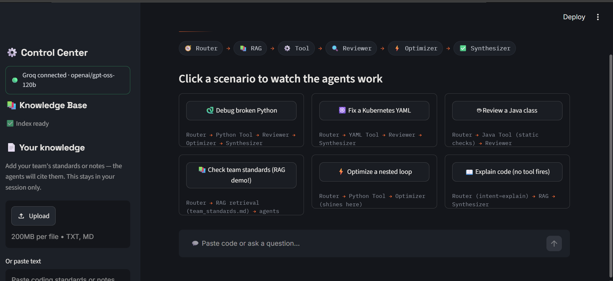
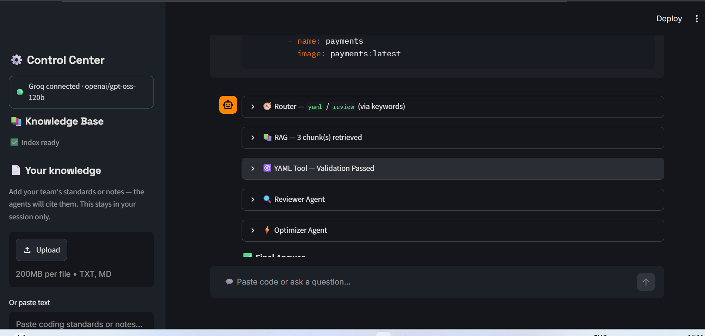

# 🔨 CodeForge Agents

**Watch AI agents debug, review and optimize your code — live, with the hood open.**

Built for the CMRIT FDP *"Agentic AI: Development of Intelligent Agents with Modern AI Frameworks."*

Paste code or ask a question → a **Router** classifies it → **RAG** retrieves from a local knowledge base → a deterministic **Tool** runs (Python sandbox, YAML/K8s validator, Java checker) → **Reviewer**, **Optimizer** and **Synthesizer** agents reason over the result — every step visible in the UI.

> Works **with or without** a cloud key. The LLM uses a **fallback chain**: 🟢 Groq → 🟡 local Ollama → 🔴 Tools-Only Mode. As long as one backend is reachable, the app answers — and it never crashes when none are.
>
> No key on the command line required — **paste a Groq key right in the sidebar** (it stays in your session, never logged), or supply it via `.env` / a Kubernetes Secret.

---

## 🆕 Recent improvements

- **📄 Bring your own knowledge** — upload a `.txt`/`.md` file or paste text in the sidebar and the agents cite *your* standards/notes alongside the built-in knowledge base. Per session, in-memory, nothing written to disk. ([Details](#-bring-your-own-knowledge-per-session))
- **🔑 API key from the UI** — connect Groq by pasting the key in the app, not just on the command line. The `.env` / Secret path still takes precedence, so Docker and Kubernetes are unchanged.
- **🐳 Faster container start** — the ONNX embedding model and Chroma index are now baked into the image **as the runtime user**, so containers no longer re-download the 79 MB model on every start. Fully offline-ready.
- **🔒 Session knowledge isolation** — uploaded knowledge is stored separately for each browser session, preventing one user's uploads from appearing in another user's results.
- **📸 Application screenshots** — added screenshots of the main dashboard and agent execution trace.

---

## 🏗️ Architecture

```text
             ┌──────────────────────────────────────────────┐
             │                Streamlit UI                  │
             │  Router │ RAG │ Tool │ Reviewer │ Optimizer  │
             │                  │ Synthesizer               │
             └──────┬───────────────────────────┬───────────┘
                    │                           │
         ┌──────────▼──────────┐     ┌──────────▼──────────┐
         │   RAG + Tools        │     │   LLM Fallback Chain │
         │  ChromaDB (ONNX      │◄────┤  Groq → Ollama →    │
         │  MiniLM embeddings)  │ctx  │  Tools-Only          │
         │  python/yaml/java    │     │  llama-3.3-70b /     │
         │  deterministic tools │     │  local mistral       │
         └──────────┬──────────┘     └──────────┬──────────┘
                    │                           │ (cloud, optional)
             ┌──────▼───────┐            ┌──────▼───────┐
             │ knowledge/   │            │   Groq API   │
             │ *.md index   │            └──────────────┘
             └──────────────┘

Git push ──► GitHub repo ──► ArgoCD (auto-sync) ──► Kubernetes
                                  ▲                    │
                                  └── self-heal ◄──────┘
docker build ──► Docker Hub (appars/codeforge-agents)
```

**The agentic part:** each request flows through a pipeline of specialised agents. The Reviewer judges correctness against the deterministic tool result (it never guesses whether code ran), the Optimizer proposes safe improvements, and the Synthesizer merges everything — tool output, retrieved knowledge, both agents' notes — into one streamed answer. The full trace is expandable in the UI.

---

## 🚀 Local Development

Clone your fork:

```bash
git clone https://github.com/Sourabhpw/codeforge-agents.git
cd codeforge-agents

python3.11 -m venv .venv
```

Activate the environment:

**Windows PowerShell:**

```powershell
.venv\Scripts\Activate.ps1
```

**Linux / macOS:**

```bash
source .venv/bin/activate
```

Install dependencies:

```bash
pip install -r requirements.txt
```

Build the knowledge index once (no API key needed — embeddings are local):

```bash
python -m rag.ingest
```

Start the application:

```bash
streamlit run app.py
```

Open the application at:

```text
http://localhost:8501
```

Click a **Demo Scenario** card to watch the full pipeline run on a planted bug.

### Run tests

```bash
pip install pytest
pytest -q
```

---

## 🔑 LLM Configuration (the fallback chain)

The app tries backends **in order** on every request, so a rate limit or a missing key degrades gracefully instead of failing:

| Mode | Indicator | When it runs | Features |
|---|---|---|---|
| Groq | 🟢 | `GROQ_API_KEY` set and under quota | Full pipeline on `llama-3.3-70b-versatile` |
| Ollama | 🟡 | Groq unavailable, local Ollama up | Full pipeline on a local model |
| Tools-Only | 🔴 | No LLM reachable | Sandbox + YAML/Java validation + RAG, no agents |

Get a free Groq key at <https://console.groq.com/keys>.

Resolution order:

1. `.env` file → copy `.env.example` to `.env` and set `GROQ_API_KEY=gsk_...`.
2. Environment variable → set `GROQ_API_KEY`.
3. Streamlit Cloud → **Settings → Secrets**.
4. **App sidebar** → paste the key into the 🔑 *Connect an LLM* field — stored in that browser session only, never logged or saved.
5. Nothing → 🟡 Ollama if running, else 🔴 Tools-Only.

A key from sources 1–3 takes precedence, so the sidebar field only appears when no key is configured.

For the best **local** experience, install [Ollama](https://ollama.com) and pull a coder model:

```bash
ollama pull qwen2.5-coder
ollama serve
```

Switch the chain order any time with `LLM_PROVIDER` (`auto` | `groq` | `ollama`) in `.env`.

---

## 📄 Bring your own knowledge (per session)

Beyond the built-in `knowledge/*.md` base, anyone can add their **own** material at runtime from the sidebar — a team style guide, a grading rubric, or lab guidelines — and watch the agents cite it.

- **Upload** a `.txt` or `.md` file (or several), **or paste** text directly.
- It is chunked and embedded with the **same** model as the baked index, so retrieval ranks your chunks against the built-in ones by relevance.
- Hits are badged 📄 *your upload* vs 📚 *base* in the RAG trace.
- Stored **in-memory, per browser session** (`chromadb.EphemeralClient`): isolated between users, written to no disk, and gone when the tab closes.
- Safeguards: tolerant decoding, 1 MB per file, approximately 200 chunks per session, content-hash deduplication, and a **Clear my knowledge** button.

> Plain text is chunked by paragraph; Markdown with `## ` headings is chunked by section. The built-in knowledge base is untouched — uploads live only in your session.

---

## 🐳 Docker

Build the image:

```bash
docker build -t appars/codeforge-agents:latest .
```

Run in Tools-Only Mode (no key required):

```bash
docker run -p 8501:8501 appars/codeforge-agents:latest
```

Run with Groq:

```bash
docker run -p 8501:8501 --env-file .env appars/codeforge-agents:latest
```

Push to Docker Hub:

```bash
docker login
docker push appars/codeforge-agents:latest
```

**Note:** These Docker Hub commands use the original `appars/codeforge-agents` image name. If you publish your own image, replace `appars` with your Docker Hub username.

Image highlights: `python:3.11-slim`, non-root user (UID 10001), layer-cached dependencies, ONNX embeddings (no PyTorch), built-in `HEALTHCHECK` on Streamlit's `/_stcore/health`. The index and embedding model are baked as UID 10001, so the container reads them from the same home it runs as — no model download on startup.

---

## ☁️ Deploy to Streamlit Cloud

Streamlit Cloud runs on a small container and **does not use the Dockerfile**, so it cannot build the index at boot without running out of memory. The recommended approach is to **commit a pre-built index**:

```bash
python -m rag.ingest
git add chroma_db .gitignore
git commit -m "Commit pre-built knowledge index for cloud boot"
git push origin main
```

Then on <https://share.streamlit.io>:

1. Select **New app**.
2. Choose your repository: `Sourabhpw/codeforge-agents`.
3. Select branch `main` and file `app.py`.
4. Open **Settings → Secrets** and add your Groq key in TOML format:

```toml
GROQ_API_KEY = "gsk_your_key_here"
```

5. Deploy.

> Ollama isn't reachable from Streamlit Cloud, so the chain there is effectively Groq → Tools-Only. Keep `GROQ_API_KEY` valid.

---

## 🖥️ Rancher Desktop Setup

1. Install [Rancher Desktop](https://rancherdesktop.io/) and enable **Kubernetes**.
2. Verify that `kubectl get nodes` shows the node as `Ready`.
3. NodePort services are reachable at `localhost:<nodePort>`.

---

## ☸️ Kubernetes Deployment (manual)

Create the Groq secret first (never put the key directly in a YAML file). Skip this to run in Tools-Only / Ollama mode.

```bash
kubectl create secret generic codeforge-secrets \
  --from-literal=GROQ_API_KEY='gsk_xxx'

kubectl apply -f k8s/

kubectl get pods -l app=codeforge-agents
```

Access using NodePort:

```text
http://localhost:30851
```

Or use port forwarding:

```bash
kubectl port-forward svc/codeforge-agents 8501:8501
```

Manifests follow the project's `knowledge/team_standards.md` rules: team label, resource requests/limits, pinned image tag, two replicas, secret injected from the cluster, non-root security context, readiness and liveness probes on `/_stcore/health`.

---

## 🔁 GitOps with ArgoCD

Install ArgoCD:

```bash
kubectl create namespace argocd

kubectl apply -n argocd -f https://raw.githubusercontent.com/argoproj/argo-cd/stable/manifests/install.yaml
```

Access the UI:

```bash
kubectl port-forward svc/argocd-server -n argocd 8080:443
```

Get the initial admin password:

```bash
kubectl -n argocd get secret argocd-initial-admin-secret -o jsonpath="{.data.password}" | base64 -d
```

Register the application:

```bash
kubectl apply -f argocd/application.yaml
```

ArgoCD should watch your fork at `github.com/Sourabhpw/codeforge-agents` (path `k8s/`, branch `main`) with **auto-sync + self-heal + prune**. Make sure `argocd/application.yaml` also points to your fork before deploying.

**Live demo moment 🎬:** edit `k8s/deployment.yaml` in GitHub (`replicas: 2 → 3`), commit, and watch ArgoCD detect, sync, and roll out — no `kubectl`. Then run `kubectl scale deploy codeforge-agents --replicas=1` and watch self-heal revert it. That's GitOps.

---

## 🧪 Health Check

```bash
curl -fsS http://localhost:8501/_stcore/health
```

Expected response:

```text
ok
```

Used by the Docker `HEALTHCHECK` and both Kubernetes probes.

---

## 🛠️ Troubleshooting

| Symptom | Fix |
|---|---|
| Streamlit Cloud `connection refused` at boot | Commit a pre-built index: `python -m rag.ingest` then push `chroma_db/`. |
| 🔴 Tools-Only despite a key | Check `GROQ_API_KEY` in environment, `.env`, or Streamlit Secrets. |
| 🟡 Ollama mode locally | Expected when Groq is rate-limited or unavailable; or start `ollama serve`. |
| `ImagePullBackOff` | Check that the image exists and the image name is correct. |
| Pod `OOMKilled` | Raise the memory limit in `k8s/deployment.yaml`. |
| Probes failing | Check `kubectl logs`; Streamlit may need 10–20 seconds to boot. |
| ArgoCD `Unknown` / `ComparisonError` | Check repository URL, branch, path, and repository access. |
| NodePort unreachable | Try `kubectl port-forward svc/codeforge-agents 8501:8501`. |
| First answer slow | Ollama loads the model into RAM on the first call; later calls are faster. |
| Container re-downloads the model at start | Rebuild using the current Dockerfile and check the runtime user's model and index paths. |

---

## 📸 Screenshots

### Main Dashboard



### Agent Execution Trace



---

## 📁 Project Structure

```text
codeforge-agents/
├── screenshots/
│   ├── dashboard.png
│   └── agent-trace.png
├── app.py                     # Streamlit UI (pipeline, sidebar, modes)
├── core/
│   ├── config.py              # Central config, secret resolution
│   ├── llm.py                 # LLM fallback chain (Groq → Ollama → none)
│   ├── router.py              # LLM + keyword intent/language classifier
│   ├── memory.py              # Conversation memory window
│   ├── scenarios.py           # Demo scenario cards
│   └── ui.py                  # Design system (the "forge" theme)
├── agents/
│   ├── base.py                # Shared agent contract
│   ├── reviewer.py            # Correctness / risk review
│   ├── optimizer.py           # Safe improvement suggestions
│   └── synthesizer.py         # Streams the final answer
├── tools/
│   ├── python_runner.py       # Sandboxed subprocess execution
│   ├── yaml_validator.py      # YAML + Kubernetes structure checks
│   ├── java_checker.py        # Java heuristics
│   └── extract.py             # Fenced code-block extraction
├── rag/
│   ├── embedder.py            # ONNX MiniLM embeddings (no torch)
│   ├── chunking.py             # Markdown and plain-text chunking
│   ├── ingest.py               # Build the ChromaDB index
│   ├── retrieve.py             # Retrieval + relevance threshold + session-KB merge
│   └── user_kb.py              # Session-scoped knowledge store
├── knowledge/                  # Markdown knowledge base
├── chroma_db/                  # Pre-built index (if committed)
├── tests/                      # Unit + fallback tests
├── k8s/                        # Deployment + service (NodePort)
├── argocd/
│   └── application.yaml        # GitOps app configuration
├── Dockerfile                  # Python image, non-root, healthcheck
├── requirements.txt
└── .env.example
```

---

## 📜 License

MIT — built for teaching. Reuse freely in your FDP sessions.